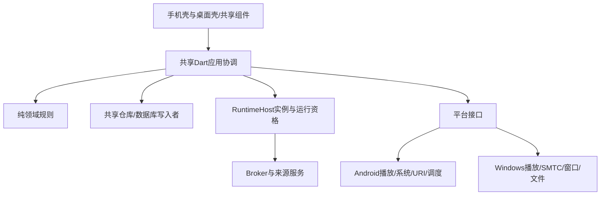

# 架构与规范合同

分类P/H；见ADR-0002。此处是消息/状态权威源；字段修改先更新本章、ADR、消费者任务和测试，不只留在聊天。合同版本初始建议`1`，尚无生成代码。

## 模块与依赖

建议新增`clients/flutter/`，不搬旧Electron根目录。一个Flutter应用先用目录边界：

```text
lib/app/                         composition与运行时入口
lib/domain/                      纯Dart身份/播放/资料/下载/歌单/资源规则
lib/application/                 协调器、命令、查询与恢复
lib/data/database/ repositories/ migration/ cache/
lib/platform/contracts/ android/ windows/
lib/presentation/state/ components/ layouts/mobile/ layouts/desktop/ pages/
test/ integration_test/
```

domain不依赖Flutter/数据库/平台；application只依赖接口；data/platform实现接口；UI提交意图、订阅快照。Kotlin/C++不再实现随机队列、匹配、音质阶梯或歌单。先不为目录拆大量package；纯Dart需要独立运行时再拆。



## 所有权

| 对象 | 唯一权威 | 其他层 |
| --- | --- | --- |
| 队列/模式/随机/试听/下一资源 | PlaybackCoordinator | UI/通知/托盘/系统键只提交命令 |
| 解码、缓冲、实际输出和句柄 | PlaybackBackend | 回报事件，不能另改业务队列 |
| 数据库业务事务 | 共享Repository写入者 | 同engine/多入口也不建第二写入者 |
| 下载业务、重解析/发布/入库 | DownloadCoordinator | 执行器只字节及检查点 |
| 脚本修订/能力/启停/请求 | SourceManager | 播放和下载各有使用者持有 |
| 上游URL/头、资源授权/流 | MediaBroker/受控Transport | UI不持有；后端只受控资源 |
| 目录扫描提交 | LibraryCoordinator | 平台只枚举/读取，晚结果须复核 |
| 歌词封面选择/待写入 | AssetCoordinator | 页面预览，显式请求写入 |
| 页面筛选/滚动/选择/面板 | UI状态 | 不能决定服务释放 |
| 运行时实例/连接排他接管 | AppRuntimeHost | 不包含播放/下载业务策略 |

AppRuntimeHost是边界角色，不预设为一个能跨所有进程永生的对象。其原生/插件落点必须由A04/A07/B07证明；权威宿主也死亡则R3。原生可保存由Dart提交的队列/恢复镜像，不自行改镜像中的规则。

## C-01：标识与通用消息

| 字段 | 责任与变化 |
| --- | --- |
| protocolVersion | 连接握手，不兼容拒绝 |
| requestId | 单请求唯一；重试与幂等关系明确，不滥用一个ID |
| playbackSessionId | 逻辑播放会话；R1/R2可保持，R3按可恢复逻辑保留或明确结束；进程实例不能冒充它 |
| uiConnectionId | 新UI连接变化，不影响播放资源 |
| coordinatorEpoch | 权威协调器接管后变化；只有存活权威能签发，不能本地自增就宣称排他 |
| backendEpoch / brokerEpoch | 对应真实实例重建变化；不因页面变化 |
| playbackGeneration | 使准备请求/意图失效；不是全资源统一撤销号 |
| queueRevision | 成功队列变更后递增，进度tick不变 |
| entryId / trackKey | occurrence与原业务身份分开 |
| trackHandleId / transitionId | 实际音轨/一次渐变，角色变化不重建句柄 |
| sourceRevision / sourceGeneration | 内容摘要与JS运行实例分开 |
| resourceRevision / consumerId | 媒体表示与具体读取者 |
| eventSequence | 对应实例内递增，不跨实例盲比 |
| playbackConfirmationId | 项目级首次播放确认的去重凭据；由共享协调器在C-05证据成立后签发，同次播放的暂停/缓冲恢复/重复事件及R1/R2沿用；不是原始后端事件名 |
| positionMs / durationMs / sampledAtMonotonicMs | 毫秒；未知duration为null，时钟只同实例解释 |

错误包含`code、stage、retryable、userMessage、diagnosticId`。至少区分取消/超时、无源/不支持、目录失败、匹配/档位失败、URL失效、权限/文件、后端断连、冲突、持久化、资源撤销。

## C-02：命令、查询和接管

- 输入：PlayIntent（单曲试听/列表快照/恢复快照、entry、播放意图）、QueueMutation（expectedRevision）、TransportCommand（play/pause/seek/stop）、AcquireController、ReleaseConsumer。
- 输出：CommandAck、PlaybackSnapshot、BackendEvent和释放确认；accepted/applied/playing/released的含义以下表为唯一说明。
- 队列快照含revision、occurrences、当前/请求条目、模式、试听、随机历史/预留和恢复位置；不包含可重放令牌。
- `AcquireController(expectedOwner, session)`在存活权威处串行比较交换；旧owner失去发命令资格。没有权威可确认，不能只凭超时抢占，进入R3。
- UI重连查询完整snapshot+事件游标，原子接续或重新取snapshot避免间隙；UI不能用过期本地状态回写。
- 后端事件按backendEpoch/handle/sequence，渐变再按transition；旧解析按请求/generation丢弃。合法outgoing的释放事件不能因不等于主曲generation而丢弃。
- Cancel(requestId)幂等；取消发布资格和实际中止分别确认。通道断连使操作不确定，先取快照，不重放所有旧命令。

### 短串行与异步完成

串行的范围仅为**意图接收与权威状态提交**：校验当前owner/修订、更新desired状态/受影响准备的generation与发布资格、登记命令/资源角色及派发动作；每个提交段有界，不把整个播放Future塞进串行链。网络/JS解析、资源准备、后端load/seek/停止释放、文件持久化等长操作异步运行；完成时重新进入短提交段，按requestId、相应epoch/generation、handle和角色核验后才发布结果。

Stop、Cancel、Pause或新PlayIntent不能等待旧解析、加载或整个播放Future结束才能被接收/提交；不需要泛用优先级任务调度框架。新意图先使其作用范围内旧任务失去发布资格，再异步请求底层取消/停止；取消/释放确认另行到达。Pause不等于释放，不把所有音轨/下载统一撤销；其desired状态也必须防止旧加载迟到后擅自播放。过期成功/错误不能回写新状态，但已分配资源的清理和合法outgoing释放仍须按C-04处理。异步完成与新命令竞争时只以短提交段中的权威状态为准。

取消/停止/暂停控制的**派发也不能挂在旧Future完成之后**；有有效通道/句柄时独立发出，无句柄时完成准备失效/取消意图。只有通道不可用或明确的资源释放前置可显示有界pending，不能把“等待旧load Future”包装成已响应；后端无法中断/处理控制须作为能力缺口或有界故障退路记录。新意图可先准备可用资源，必须等同一物理后端释放的部分单独等待released，不阻挡后续控制，也不伪称释放已完成。

| 信号 | 精确含义 | 不证明 |
| --- | --- | --- |
| accepted | 命令已通过入口校验并被权威协调器接收，有可查询的requestId/结果 | 已改状态、已持久化、后端已执行或出声 |
| applied | 该命令对应的共享层权威状态变更已提交，所需后端动作已派发或登记为待派发；如停止意图/旧准备失效已落实 | 后端已物理暂停/停止、资源已释放、保存已落盘或已播放；UI仍可显示后端确认pending |
| playing | 经C-05映射及共享层有效性核验形成的项目级音轨播放确认，可签发/复用playbackConfirmationId | 按钮/布尔值叫playing即有效，或人耳/设备实际出声已验证 |
| released | 指定消费者/handle的底层读取与资源占用已按实际能力确认结束，才能回收对应持有 | 同会话其他轨/下载也结束，或Cancel/applied已自然完成释放 |

失败、撤销或不支持必须有对应错误/命令结果，不能用applied掩盖后端失败。需要持久化证明时另以存储完成凭据登记快照修订，不改变applied含义，也不在命令提交段等待磁盘。TC-56用一直不完成的受控Future核对命令提交与迟到结果；不运行真实源或为此增加网络前置。

## C-03：三种恢复

| 流程 | 顺序与不变量 |
| --- | --- |
| R1 UI重连 | 新uiConnectionId→snapshot+游标→恢复页面；会话/coord/backend/broker/租约不变，不load/play、不重复历史 |
| R2协调器重建 | recovering→排他接管→读取存活组件+持久快照/日志→核对queue/handle/transition→接管并发布；能一致则不重播；不一致暂停恢复 |
| R3组件/进程重建 | 仅更新实际死亡组件epoch；后端死释放旧handle；Broker死旧端点/令牌失效；全进程死从持久身份/位置恢复，默认暂停 |

Activity事件不能替代存活检测。引擎毁灭导致Broker/协调器一起死亡是组合R3，不承诺Dart继续。系统媒体合法恢复请求单独处理；用户强制停止不自动复活。

若协调器接管时双轨无法可靠对应，不猜随机或下一首；收敛到后端可验证单轨/暂停。历史按确认ID去重。R2无损接管是H，必须验证，不能预设原生快照总能重建全部业务。

### P1最小持久快照适配

A02在首批合同工作内提供窄的RecoverySnapshotStore读/保存边界与隔离文件原型适配器；唯一文件归属见任务索引，A07消费其落盘完成凭据，不依赖P2数据库。仅用于自有恢复实验，不打开Electron数据目录、不迁移真实数据、不安装正式DB依赖。

最小内容：快照格式版本、runId/快照修订、逻辑会话、少量自有fixture的条目/队列顺序/当前索引、模式/试听、恢复位置，及验证去重所需的已确认凭据。资源以fixture身份映射到本次获准测试文件；不保存原生handle/租约、运行epoch、源脚本、URL/token/头、真实授权引用、完整曲库/下载/资产/生产历史。字段沿C-01/02，不另立一套队列语义；P1只验证该有限集合。

运行目录必须由测试显式选择并带runId：Windows使用批准的临时/诊断隔离目录，Android用诊断应用私有目录下的prototype-recovery子目录；都不与旧客户端或将来的正式库共用。记录有限条目/字节上限。保存需校验版本/结构与修订，按已验证文件能力写临时副本再发布，只有实际完成后报告saved修订；不能在内存更新后伪报落盘。旧快照保护和中断写入行为要实测，不把进程强杀通过外推为断电/文件系统原子性保证。

快照保存自身须按修订有界串行或等效防旧写覆盖，慢磁盘不占用命令提交段；saved只证明其对应修订。实验控制方核实要恢复的保存修订后再终止进程，不把applied当保存完成，也不通过把磁盘Future串进命令链来保证顺序。

TC-05必须在前进程实际保存并取得对应修订完成证据后，由实验控制方终止进程，再显式启动新进程；记录进程/实例区别，新进程实际读取同一隔离目录的前次快照并核对修订/fixture/位置，默认暂停，不伪造续播。强杀不得依赖退出flush回调，内存fake/同进程重建不能替代；缺失/损坏/未知版本或fixture不可用时保留安全诊断、拒绝其运行引用，回到空/可明确恢复的暂停状态，不自动加载私人资料、联网或无限重试。中断写入另测：可用最后有效快照，否则走缺失退路，不能硬要求未完成保存必然存在。

P2由正式Repository实现同一窄边界，在原型fixture上复验并补事务/升级/生产恢复；默认关闭/移除生产装配中的文件原型，只可在显式测试配置保留为参考实现，不与正式库双写，不自动把原型快照升级为用户数据。端口变更回写本章和消费者，替换方式在WP-P2-DATA/PLAY批次中确认。

## C-04：逐音轨资源

每handle记录业务entry、后端实例、角色、资源修订/租约/来源、读取者及确认/撤销/释放状态。角色`active/prepared/incoming/outgoing/retiring/released`；初期最多两轨，渐变时不另预载第三首。

| 时点 | A旧轨 | B新轨 | 主身份/历史 |
| --- | --- | --- | --- |
| B解析/预载 | 保持音轨与租约 | 准备请求或prepared持有 | A，不记B |
| B等待playing | 保持 | incoming未确认 | A |
| B形成项目播放确认且本次交接可提交（项目transition started） | outgoing继续持有 | incoming持有 | 共享层提交B身份/歌词/系统状态；历史按确认凭据记一次，不释放A |
| completed | 停A→确认释放→回收 | B转active | B |
| 项目交接started前B失败/取消 | A不变 | 停/释放B | A |
| 项目交接started后B失败 | A仍可用才恢复 | 停/释放B | 回滚A；B已发生历史保留 |
| A已结束/撤权后失败 | 不可回滚 | 失败状态 | 不伪报恢复 |

操作作用域：cancelPrepare仅准备；releaseTrack等后端不再读取；revokeSource硬撤销对应来源；stopPlaybackSession终止播放两轨但不下载。释放一个消费者不影响其他消费者。UI订阅不是持有计数。

手动切歌取消旧准备，但A淡出结束且停止读取前保留资源；旧轨释放确认仍接收。seek在交接前取消prepared定位A，交接后完成交接释放A定位B。pause不等于release，可关连接但保留恢复持有。释放无确认进入有界故障处置，必要时销毁后端；不无限泄漏。

来源撤销/文件授权失效优先于回滚。准入TTL、音轨持有、远端URL有效期分开，详见Broker。

本章started/completed是共享层接受证据后生成的**项目交接状态**，不是与后端同名事件直接互换。历史确认和身份交接各自按C-05规则消费证据，不能用一次原始回调同时跳过两者校验；P1只验证合同/受控双轨，不提前实现P8渐变。

## C-05：平台接口职责

PlaybackBackend消费受控ResourceRef与Transport，输出ready/playing/buffering/progress/ended/error/released，支持能力查询。预载/交接可选但不能假报成功；原生不自行跳到未授权条目。

### 后端事件归一化交付合同

上述是项目合同名。A03/A05须分别基于选定后端固定版本的真实API/上游定义和实际原型日志，交付一份平台事件归一化表；表的判断表达式在原型后回写，不由本文猜测。原始回调/布尔值叫playing、started或ready不构成证据；按钮命令成功也不构成项目播放确认。无法可靠区分则标不支持/待验和保守退路，不能自行拼一个通用表达式宣称通过；更换后端需重做映射。

| 映射表必填维度 | 必须给出的证据/规则 |
| --- | --- |
| 来源 | 平台/后端及版本、原始API/字段/线程/回调顺序、官方或上游链接、可复现日志/用例；原始到项目事件的条件和无法判断项 |
| 准备至首次确认 | 区分用户播放意图、load进行中、buffering、ready/可播放和项目确认；预加载就绪不等于播放，不以单一同名布尔值或时长/进度孤立推断代替证据 |
| 暂停/缓冲恢复 | 开始前缓冲、缓冲中暂停、暂停恢复、缓冲恢复与重复回调分别如何归一化；旧desired状态不能在恢复后抢播 |
| 结束/中断 | 自然结束、主动stop、加载取消/失败、旧轨结束分别来源及归属；只有当前有效自然结束才能按现有队列规则推进，其他事件仍处理其释放，不误记下一首 |
| 有效性 | 对应request/generation、backendEpoch、handle/entry、eventSequence及transition的核验落点；乱序、重复、已取消与旧轨事件如何丢弃发布或仅作资源回收 |
| 两类业务消费 | 项目首次播放确认如何签发playbackConfirmationId；暂停/缓冲恢复、重复事件及R1/R2不重记最近/收集。交叉渐变另需本次incoming/transition仍有效且交接政策允许，才提交一次项目started；预加载/ready/原始started不能提前交接 |
| 限制/退路 | 无法证明的ready/playing/ended/双轨能力，原型与生产/系统设备证据差异；不足时延后验收或禁用该能力，不假报成功 |

最近播放/在线收集只消费有效首次项目确认并按确认凭据去重；是否属于本地、在线及收集资格继续按PR-07/08，不靠每个恢复回调再收集。P1本地原型以自有fixture及收集回执替身核查去重，不发真实在线请求；生产在线收集在原阶段接入。明确新的重播/条目播放仍按原产品规则建新确认，不能用去重吞掉合法播放。交接提交与历史记账是不同的共享层操作：同一合格证据可能触发二者，但必须分别核验；回滚不抹去已发生的B历史，资源释放仍等C-04确认。

项目playing只代表选定后端能证明且已归一化的播放开始/运行状态，不代表人耳听感、静音解除或设备必然出声。TC-57覆盖映射和反例；音频设备/后台/听感仍各自验收。A03/A05前没有实际API映射或运行证据，本文不预填判定表达式。

SystemMediaAdapter镜像确认状态、回调共用命令入口；FileAccess返回授权引用和read/seek/write/atomicReplace能力；MetadataReader/Writer只处理授权资源；SourceRuntime只执行兼容请求；CatalogAdapter返回资料+完整性；TransferExecutor返回执行事件/检查点，不直接提交业务完成。

原生无UI时只消费共享层已批准的当前/下一资源票据；无法联系协调器不重新匹配/随机/换源。高级预批准连续播放需单独ADR，不默认复制整个队列。

## C-06：时钟与运行持有

进度前台建议250ms采样、局部插值，seek/pause/切歌/错误立即更新；后台减频、停止频谱/背景绘制，最终频率实测。不能用UI帧驱动音频。

RuntimeHost分别登记playbackRef、downloadRef和系统运行资格。引用不是突破系统限制的保活保证。停止播放不释放下载持有；无使用者则有界flush、停宿主/流/后端、释放会话。共享源按使用者持有，不能随播放器停止统一关闭。

### 2026-10-31 P1诊断实现记录（字段权威补记）

A02维护者在AUTH-A03-A08范围内串行补冻结p1-a02-v2：PlayIntent/PrepareRequest增加可选startPositionMs（默认0，非负，参与请求签名）；真正播放前由后端派发定位，项目确认仍须原生实际运行证据。fresh-authority的restoreSnapshot只消费已校验隔离RecoverySnapshot，恢复队列/确认记录/位置为paused，不恢复handle/运行epoch、不自动prepare/play；空队列/-1安全空态。backendReleased只接受可信宿主逐轨物理释放凭据，保持协调器与Broker epoch，递增backendEpoch并暂停；超时不是销毁证据。恢复后新命令须本运行epoch，重复resume仍幂等。

P1具体原生映射与限制见evidence/p1-a/20261031/android-event-mapping.md及windows-event-mapping.md；真实样本的原生准备/运行状态加直接位置推进，结合本章身份/代次/意图才形成首次确认，不能把API布尔/ready直接当项目playing。硬切在新轨确认前失败或取消时，只在旧active仍有效且desired仍playing时恢复其物理播放；paused意图不得被回滚覆盖。未完成的持续缓冲/未知时长等维度不得据此宣布通过。

### P1 A02 v2.3 定位能力增量（2026-10-31）
PreparedTrack新增必填可空canSeek：true明确支持、false明确不支持、null尚未知。它绑定当前资源，当前诊断适配只使用准备完成时的原生能力；后续动态能力变更不在本批保证。共享seek在改变generation/position、取消准备/释放音轨或派发原生前检查，false拒绝seek-unsupported，null拒绝seek-capability-unknown；拒绝不制造播放确认。applied仍表示短提交，不是定位已完成。能力不持久化进恢复快照；重新prepare须再取。协议/快照格式仍1，旧v2.2冻结保留，新源码消费者必须使用v2.3。不支持的恢复定位仍由原生失败退路处理，不自动忽略目标位置。
