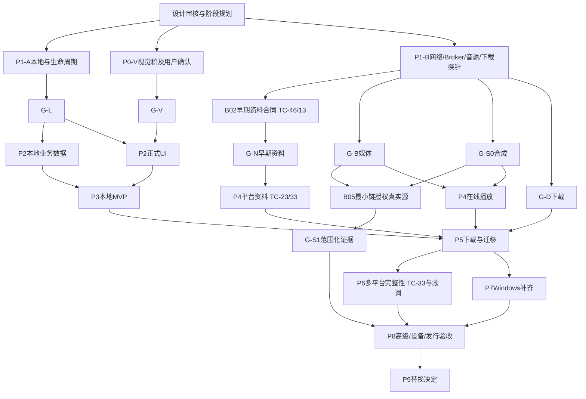

# 阶段与风险门

本文件定义阶段，不是自动实施授权。任务依赖唯一来源为[任务索引](tasks/README.md)，任务状态/门结果为[status](status.md)。R4已填全部阶段细任务；阶段开始的入口任务只对齐当时真实原型/工具/树/版本和精确allowlist，不再把远期仅当标题，也不另设计一套架构或增审批。

## 门定义

| 门 | 含义与最低证据 | 不代表 |
| --- | --- | --- |
| G-L | A系列：双端本地、系统基础、三恢复、唯一队列及资源合同 | 网络/完整后台下载/生产完备 |
| G-V | V01稿件及V02用户对版本/范围确认 | 性能/后端/真实源 |
| G-N | B02：早期受控资料传输、通用envelope及部分失败合同（TC-46；底层传输另满足TC-13） | P4/P6平台适配、TC-23/33通过或真实端点可用；不要求安装音源 |
| G-B | B01/B02/B06的本机媒体HTTP、安全、背压/恢复 | P8完整渐变或任意CDN |
| G-S0 | B03/B04自有JS兼容向量、隔离与取消 | 真实脚本兼容 |
| G-S1 | B05a/b经授权小量真实初始化/解析/播放，按平台/profile声明 | 全部源/未来版本/生产稳定性 |
| G-D | B07/B08无播放后台、检查点/恢复、去重/单writer | P5质量/发布/入库全通过 |

G-N可独立于G-S1推进无源资料；在线音频开发需G-B/G-S0，公开声明兼容/日用还需对应G-S1及生产验收。未授权则保留G-S1未通过，但不阻塞本地或无源浏览。

G-N只看B02的TC-46与TC-13早期证据，不依赖P4/P6。TC-46用自有受控端点及合成资料验证传输、通用结构和局部失败；不实现各平台schema。P4按选定平台执行TC-23与TC-33相应部分，P6扩展其余平台及完整性；TC-33必须逐平台登记覆盖，不能把早期探针改记为平台通过。

门在其任务证据齐备后分别登记；B09是汇总而非所有门的唯一签发前置，B05b不需要等待B09。这避免把下载探针又变成真实源实验的隐含前置。

## 依赖示意

图中G-S1不依赖P4：B05只用最小诊断链；G-B两轨合同不依赖P8完整渐变。P1-B网络核心可从A02合同开始，后端恢复联调需A03/A05/A07；不要求P1-B全完成才能P2本地。

P1-A内部先由A02冻结共享本地播放测试合同和夹具，再允许A03/A05各自的平台入口并行；共享文件唯一归属与冻结证据见[任务索引](tasks/README.md)。本图不替代该任务前置。

## 阶段验收表

| 阶段 | 目标/范围与交付 | 依赖/明确暂缓 | 验证与退出 | 风险/回退 |
| --- | --- | --- | --- | --- |
| P0 | 审计/参考/规则/合同/文档审阅 | 不产品实现 | 需求覆盖与用户审核；文档证据 | 提案不冒充批准 |
| P0-V | 双端视觉/状态/动效/压力稿 | 可与技术并行，不正式UI | G-V具体版本确认 | 修改稿，不先编码定视觉 |
| P1-A | 双端本地、系统基础、R1/R2/R3、所有权 | 不完整音源/产品页面 | G-L与依赖ADR | 换后端/明确暂停恢复；Electron保留 |
| P1-B | G-N/G-B/G-S0/G-S1/G-D各自探针 | 不完整在线/下载产品；真实源另授权 | 各门分别记录，不“全P1通过” | 哪个失败阻对应能力；本地继续 |
| P2 | 扫描/本地搜索/队列/基础歌词/会话、真实UI；存储分类/支持范围/文本与IME | 业务G-L；UI还需G-V；高级音效/复杂云盘暂缓 | 两端本地闭环、TC-47—50适用范围 | 后端缺口回P1；保守支持边界，不扩大P1 |
| P3 | Android日用/焦点/蓝牙/授权/基础歌单；Win冒烟；获选时首发分发/诊断 | P2；完整在线/下载、可选外部入口暂缓 | 真机本地路径、Windows同版；首个对外包检查TC-45/53/54适用项 | 不稳定保持测试态；可仅内部日用，诊断导出UI可延期 |
| P4 | 单平台资料、源管理、解析/Broker/错误 | 资料G-N；播放G-B/G-S0，日用兼容G-S1 | TC-23、TC-33选定平台范围；playing确认/取消/恢复 | 平台故障局部降级；早期探针不代适配 |
| P5 | 严格下载/续传/发布/入库/歌单/备份定位迁移 | 依赖P3/P4相应能力、G-D | 中断恢复、无覆盖、单writer | 临时导入失败可弃、旧数据不变 |
| P6 | 多平台资料/分页完整性/来源链/待写入/增强歌词 | P5；专业输出暂缓 | TC-33逐平台schema/周期/分页覆盖，格式golden、partial/CAS/写文件 | 未覆盖平台仍待验；不以G-N替代 |
| P7 | Windows旧资料全量/桌面歌词/输入/DPI/托盘休眠/输出/独立更新 | 核心闭环；未证高级仍暂缓 | 双客户端并行/迁移回退 | 独立目录和更新通道 |
| P8 | 过渡/渐变/EQ频谱/DLNA/性能/可访问性/发行 | 对应实验及生产测试，非只看原型门 | 真设备/听感/成品/签名 | 能力开关；未验保实验态 |
| P9 | 功能差距确认、迁移退回演练、停Electron常规功能 | 必需差距关闭或明确接受 | 用户替换决定及维护政策 | 不按日期强推，不丢旧唯一副本 |

单平台初建议wy因当前详情链较完整，不代表实网更稳定；PREP阶段可依证据改tx并记ADR。其他OS/同步/竞品全部功能不进时间表。

## 阶段开工与变更

计划须核已有任务的目标/非目标、基线/allowlist、唯一依赖、合同/稿件版本、步骤/TC/命令、失败出口/证据。R4任务已实填，未证的具体API/字段/设备由条件分支负责任务确定；未满足不能ready。已有合理实施授权不反复询问，阶段内可连续小批次；独立视觉/私有源/提交发布边界不得继承。

任务以独立可审查行为，不先堆全静态页面、不长期只造底层。后端变化重跑受影响门，接口变化先更新仓库消费者。原WP只保留backlog范围映射，实际执行读分阶段手册；任务地图是导航，不维护第二份DAG。

## R3.2横向事项的阶段边界

保持上方全部风险门及P1范围。现在只确定安全/兼容边界与决策最晚时点，细节见review RV-16—21和03/04/08/10；不新增全局门或A/B探针。P2前展开存储与扫描/文本golden及数据目录约束；P3本地最低支持与首次分发安全；P4再验网络查询/源文件预算；P5/P6再验part/成品/写标签/用户资产保护；P7展开Windows包装/拖放/实例与可选关联；P8补完整发布和资源/性能验收。

阶段内只对已启用功能执行相应TC。Android分享、自然数字排序、多语言、自动云盘下载、便携多实例不自动加入；诊断导出UI可登记延期。首个对外Android包可能早于P8，此时标识/签名/系统备份/手动升级与数据回退的适用安全验收不能拖到P8。没有首次对外包则保持未运行，不为文档齐全假称已发行。
