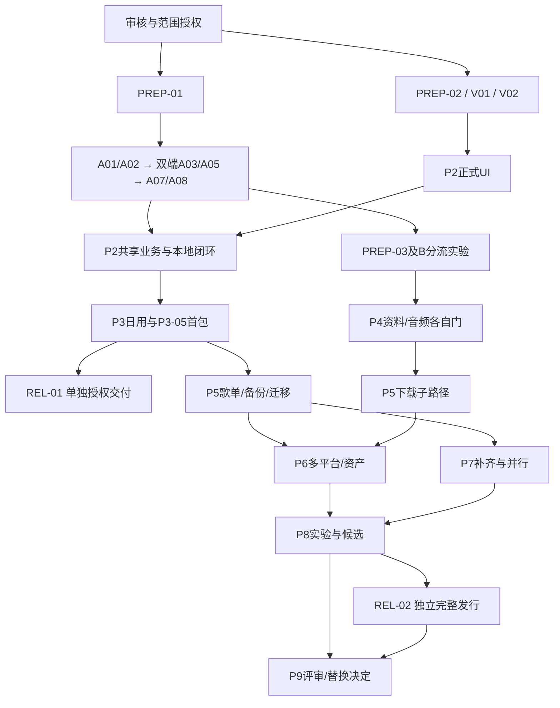

# 从审核到发行与替换的任务地图

这是任务导航视图，**依赖/门唯一看tasks/README，阶段/门含义仍看09**。本轮只交付手册，不能照此自动编码。原型可能失败，路径不是工期承诺。

| 区间 | 从哪里开始/为什么 | 小批次顺序与输出 | 退出/仍可能阻塞 |
| --- | --- | --- | --- |
| P0 | 审核R4，再授权PREP-01；视觉规划可独立PREP-02 | PREP-01锁环境/候选/前三执行合同；V01静态双端稿→V02记录具体确认 | 无对应授权停；缺工具记限制，图稿不是产品 |
| P1-A | A01→A02，先证明双端共享能成立 | A03/A05平台映射→A04/A06系统→A07真实文件重启→A08审G-L | 四合同落实，不依赖在线/P2；缺端/真实文件不通过 |
| P1-B | A02后PREP-03 | B01/B02媒体/早期资料；B03/B04合成宿主；B05a早期实源解析→B06资源联调→B05b实源媒体；B07/B08无播放下载→B09分门汇总 | G-N/B/S0/S1/D分别看证据，不把全部B作为本地前置 |
| P2 | P2-00承接本地门 | P2-01正式存储→02预算/03根/04扫描→05搜索；06队列恢复与07基础词；08组件→09列表/10播放→11歌词/12队列→13双端闭环 | 正式UI只在G-V确认范围；P1文件原型退出生产装配 |
| P3 | P3-00定义本地日用与首包选择 | 01授权、02基础歌单、03焦点后台、04可延期诊断、05首包安全、06同版冒烟 | 本地日用可先内部使用；首对外包的标识/备份安全不能等P8 |
| 独立发行 | REL-01在P3-05已验产物后可单独执行 | 用户批准具体Android产物/渠道→交付→核实际结果 | 不等待P8高级能力；不因阶段批准自动公开发布 |
| P4 | P4-00对齐G-N/G-B/G-S0 | 01资料；02源管理/03策略→04真实媒体闭环→05在线UI→06失败/兼容集成 | 无源仍可资料；实源未授权保持对应待验，不能宣称日用兼容 |
| P5 | P5-00把独立路径分开 | 01歌单；05备份→06定位与07升级；下载满足门才02后台→03校验发布→04入库/删除；08交错集成 | 备份不等下载；写文件锁/事务边界先冻结 |
| P6 | P6-00冻结公共资料/资产 | 01—05分别五平台增量；06来源→07待写入→08安全写；09增强词；10歌单搜索/导入/刷新；11集成 | 每平台单独证据，未支持格式不承诺逐字 |
| P7 | P7-00在核心/迁移证据后补Windows | 01旧数据；02包装/实例→03拖放/可选关联；04系统、05桌面词、06布局→07并行/回退 | 不回头发现共享核心无法运行；新旧目录与更新通道独立 |
| P8 | P8-00锁高级实验/设备/预算 | 01短过渡、02双轨、03变速EQ、04可视化、05本地投放→06在线混队列、07性能/电量、08可访问性→09唯一发行候选 | 原型不代生产；不支持项需差距决定，不伪造听感/设备结果 |
| 完整发行 | REL-02在P8-09候选与首发路径后 | 两端各自渠道/构建号/签名/升级验收与独立发布证据 | 一端失败保实际部分结果，不用共享代码免双端验收 |
| P9 | P9-00给用户具体差距/回退评审包 | 用户决定后P9-01切维护范围→P9-02一次维护交接/首次复验 | 不按日期淘汰旧端，不删数据/仓库，不承诺没有bug |

图是导航而非另一份DAG；精确前置和适用条件以任务索引为准。例如B05不需要P4页面、A08不等B、TC-33不阻G-N、P1快照不等P2库。只要处于用户已授权阶段且独立门满足，agent可连续推进小批次，不要求新手每一步重确认；未授权下一阶段则停止。
